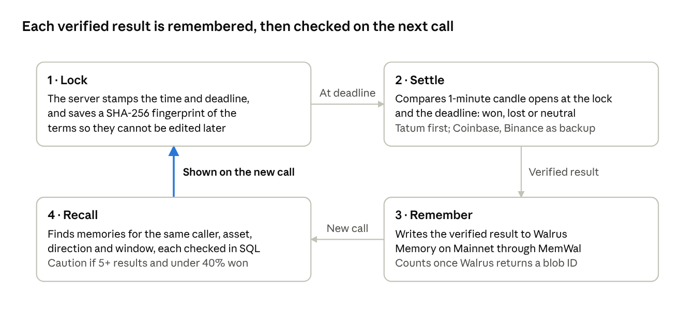
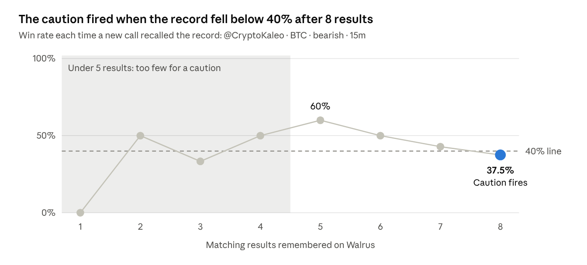

# Calls fade. Receipts stay: how CALBOK gives market calls a memory

*Nov 6, 2026 · @ILERI*

Entry for the Markets & Sports Prediction track · Tatum x Walrus Total Recall hackathon.

## Nobody keeps score

Every cycle has its prophets. Someone posts "BTC is going down, screenshot this", and the market does whatever it does. If they were right, the screenshot gets reposted for months. If they were wrong, the post gets deleted or sinks under a thousand newer ones.

That gap is the whole problem. Crypto Twitter has a perfect memory for wins and almost none for losses, so the reward goes to being loud, not right: make enough calls and a few will hit.

I wanted a place where a call gets the same treatment whether it hits or not, and where that history shows up the next time the same person speaks. That is CALBOK. The internet makes calls, CALBOK remembers receipts.

## What CALBOK is

CALBOK is a journal for market calls with a memory attached. You log a call before anyone knows the outcome, CALBOK checks it against real prices when its time is up, and it remembers how it went.

Each call has four exact parts: a **caller** (like a handle on X), an **asset** (like BTC), a **direction** (bullish means price goes up, bearish means down) and a **window** (15 minutes, 1 hour, 4 hours, 24 hours or 7 days).

Say a caller posts that BTC drops in the next 15 minutes. You log BTC, bearish, 15m, and shortly after the window closes, CALBOK knows whether it was right. When that caller makes the same kind of call again, CALBOK checks their record first, and a poor record means a caution on the new call.

## How it works: lock, settle, remember, recall

*Lock → Settle → Remember → Recall, and recall feeds the next call.*

1. **Lock.** The server stamps the time and deadline and saves a SHA-256 fingerprint of the terms, so nobody can edit them later or backdate a call.
2. **Settle.** After the deadline, CALBOK compares the opening prices of two one-minute candles (a candle sums up one minute of trading): the first at or after the lock and the first at or after the deadline. Moved the called way: won. The other way: lost. No change: neutral. No valid candle from any source: unresolved.
3. **Remember.** The verified result is queued and written to Walrus Memory on Mainnet. It only counts once Walrus hands back a blob ID, a receipt for the stored memory.
4. **Recall.** When a new call is locked, CALBOK asks Walrus Memory for memories of the same caller, asset, direction and window, and checks each one against its own database. With 5 or more matching results and a win rate under 40%, the new call gets a caution.

A background worker runs all of this on its own.

## Where Tatum fits

Tatum is the first price source CALBOK asks for every catalog asset. Each catalog settlement starts with a Tatum OHLCV request (open, high, low, close and volume), and Tatum's OHLCV catalog powers the 439-asset picker. CALBOK also calls `GetCoinInfo` through Tatum's Sui gRPC gateway to verify SUI's coin identity on Mainnet (symbol SUI, 9 decimals). That proves which coin it is, not its price.

[This AVAX call](https://calbok.xyz/call/CB-b09e0a56-915e-4938-928f-7565c63aed8c) was settled by Tatum; its page names the source.

The best lesson came from CALBOK protecting itself. Between 04:33 and 06:24 UTC on 5 November, every request for a BTC candle returned the same candle, from 29 October at 14:29 UTC: almost a week old. CALBOK checks each candle's timestamp against the minute it asked for, so it refused the candle and settled from a labelled backup: Coinbase USD first, then Binance USDT. Entry and exit always use the same source.

Tatum settled the AVAX call above at 15:05 UTC that same day, and the four newest BTC calls between 12:18 and 12:58 UTC on 6 November: 5 Tatum settlements in total. Since commit `de0db2a`, a slow or unavailable Tatum gets a five-minute window before any backup is tried; a candle for the wrong minute still goes straight to a backup.

Sources across the first 44 settlements: Coinbase 28, Binance 10, Tatum 5, GMGN 1 (an onchain token).

## Where Walrus fits

A record kept in one database on one server is one bad deploy away from gone. So CALBOK writes verified results to Walrus Memory on Mainnet through MemWal, the Walrus Memory SDK, with three rules:

- **No double writes.** If a write times out, CALBOK keeps checking on it instead of resending automatically, so a result isn't paid for twice.
- **No time travel.** A result only informs calls locked after its memory was completed.
- **Every citation is checked.** Each memory is matched to a settled call in CALBOK's database, and the recall carries the SQL query, its inputs and the rows it returned.

At the time of writing (6 November, 14:37 UTC), there are 41 completed memories on Mainnet, each with its own blob ID, and 12 recalls stored with their citations.

I also checked that the memory outlives the app: on 6 November I ran recall on `CB-be4c9da4-cb7e-476b-82b8-890a353b6e90`, restarted the production server, and ran it again. Both runs cited the same 5 receipts, jobs and blob IDs, with the same win rates. That call was locked on 5 November, before the group reached 8, and only memories completed before a call's lock count for it.

## The moment it learned

The clearest real example: @CryptoKaleo, BTC, bearish, 15 minutes. Of the eight results behind the warning, only the first came from a directly logged call; the other seven were scheduled repeats of the same terms. So this is one call measured again and again, not eight separate posts.

*Matching memories vs win rate for @CryptoKaleo BTC bearish 15m.*

On 5 November the first five results came in at 3 won and 2 lost: 60%. Recall found all five, but 60% isn't below 40%, so no caution. The sixth call, also on 5 November, lost, and the record fell to 50%. On 6 November two more calls lost: 42.9%, then 37.5% after eight results (3 won, 5 lost).

At 12:37:46 UTC the next call in the group was locked. 2.6 seconds later, recall cited all 8 matching memories, each completed before the lock and matched to a settled call. A 24-hour call it also found was correctly left out. The record was under 40% with 5 or more results, so the call showed:

> **Caution: matching calls have a low win rate.**
> 37.5% won across 8 matching calls. Open Proof details to inspect the cited results.

The scheduled series stopped itself the moment the caution fired, and a second call locked four minutes later got the same warning.

The new call's terms matched the earlier ones. Only the memory had changed, and the memory changed what the product shows.

Both warned calls then won, which I like: a caution isn't a prediction, just a summary of the record so far.

## What CALBOK does not pretend

An accountability tool that fudges its own numbers is worse than none.

- **No faked results.** At 60% after five results there was nothing to show, since a caution needs 5 or more results under 40%. I didn't log fake losses or edit the database; the caution came when real prices moved against real calls.
- **Repeats are disclosed.** Seven of the eight cited calls were scheduled re-locks, not new posts by @CryptoKaleo, and the proof file says so. The calls are private, so check them there.
- **Caller identity isn't verified.** Anyone can log a call under a caller's name, and every public card says it was self-logged. CALBOK verifies prices and timing, not authorship.
- **Unresolved beats wrong.** If price data is missing or doesn't match, the call waits. No result beats a made-up one.

## Try it

- **Watch the 2-minute demo:** [on YouTube](https://youtu.be/h_7_WKAmff8)
- **Browse:** the [live feed](https://calbok.xyz/feed) needs no account. Open any card to see its lock time, price source and Walrus blob ID.
- **Log a call:** [sign in](https://calbok.xyz/signin) with any email and a one-time code, pick a 15m window, and see the result and its memory shortly after it closes.
- **Check the proof:** the [caution proof](https://github.com/0xileri/CALBOK/blob/main/docs/proof/caution-loop-2026-11.md) lists every receipt, job and blob ID behind the warning above, next to the [restart test](https://github.com/0xileri/CALBOK/blob/main/docs/proof/restart-recall-2026-11.md) and the [Tatum Sui read](https://github.com/0xileri/CALBOK/blob/main/docs/proof/tatum-sui-rpc-2026-11.md).
- **Read the code:** it's all in the [repository](https://github.com/0xileri/CALBOK).

Not built yet: price-target calls, disputes, and checking that a post really came from the caller it names.

CALBOK was built for the Tatum x Walrus Total Recall hackathon. The idea is simple: calls fade, receipts stay, and a good memory changes what you see next time.
